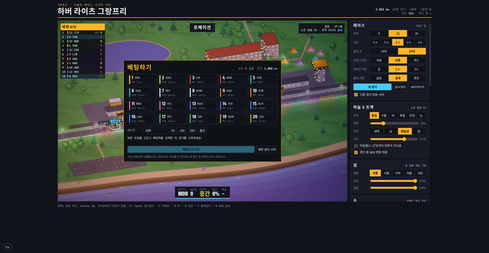
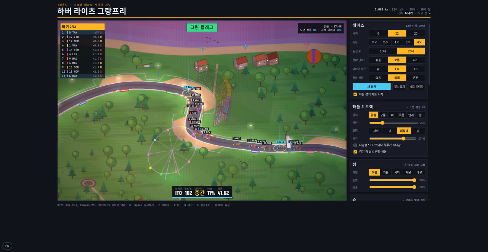
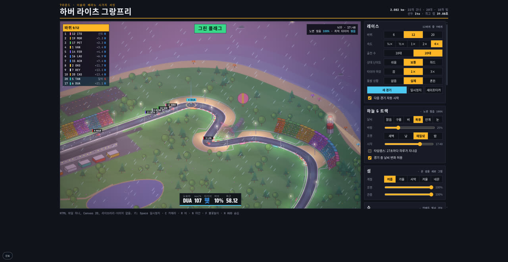
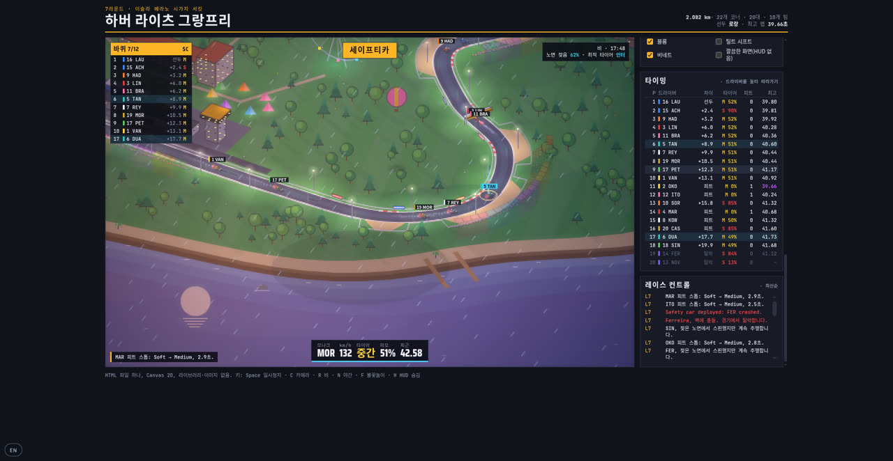
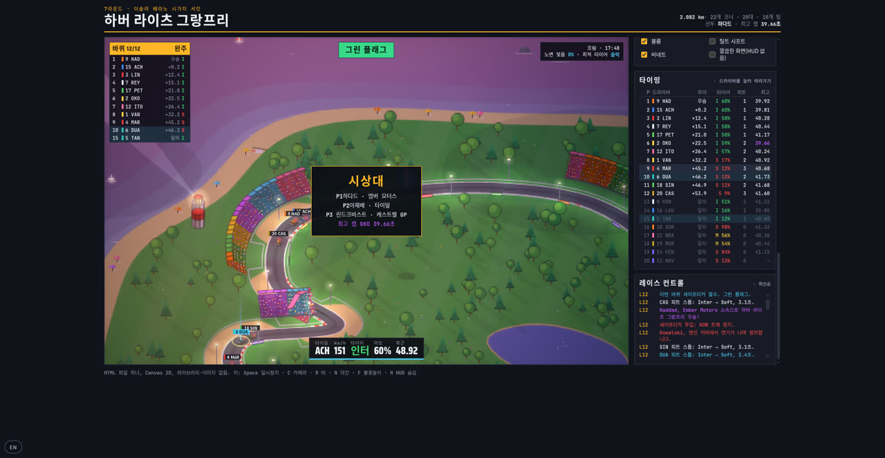

# 하버 라이츠 그랑프리 한국어판 (비공식 팬 한글화)

브라우저에서 즐기는 3D 항구 서킷 레이싱 게임 **Harbor GP**의 화면 문구를 한국어로 옮긴 비공식 팬 한글화판입니다. 게임 로직·물리·렌더링은 원본 그대로이고, 화면에 표시되는 글자만 바꿨습니다.

**▶ 바로 플레이: <https://sigco3111.github.io/harbor-gp-ko/>**

- 원작: [tetriss22/harbor-gp](https://github.com/tetriss22/harbor-gp) (커밋 `2efbb6d`)
- 원작 데모: <https://tetriss22.github.io/harbor-gp/>
- 이 저장소는 **비영리 팬 한글화**이며 원작자와 무관한 비공식 작업입니다. 아래 권리 상태를 꼭 확인해 주세요.

## 목차

1. [프로젝트 소개](#1-프로젝트-소개)
2. [권리 상태 (먼저 읽어 주세요)](#2-권리-상태-먼저-읽어-주세요)
3. [주요 기능](#3-주요-기능)
4. [실행 화면](#4-실행-화면)
5. [설치·실행 방법](#5-설치실행-방법)
6. [사용법](#6-사용법)
7. [기술 내용·구성](#7-기술-내용구성)
8. [라이선스·원작 표기](#8-라이선스원작-표기)
9. [검증 기록](#9-검증-기록)
10. [번역 범위](#10-번역-범위)

## 1. 프로젝트 소개

**무엇을** — 항구 도시의 시가지 서킷을 달리는 3D 레이싱 게임 *Harbor GP*의 화면 문구를 한국어로 옮긴 판본입니다. 원작 `index.html` 은 한 글자도 고치지 않고, 화면에 그려지는 순간에만 문구를 한국어로 바꾸는 **번역 오버레이** 방식으로 만들었습니다.

**왜** — 원본은 영어 UI만 제공합니다. 레이스 설정 패널, 레이스 컨트롤 로그, 베팅 창, 결과·시상대 문구가 모두 영어라서 한국어 사용자가 게임의 규칙과 각 화면의 의미를 바로 파악하기 어렵습니다. 이 판본은 그 문구를 한국어로 옮겨, 같은 게임을 한국어로 이해하며 즐길 수 있게 합니다.

**누구를 위해** — 브라우저에서 바로 즐기는 레이싱 게임을 좋아하는 한국어 사용자, 특히 영어 UI 때문에 설정·베팅·레이스 로그를 읽기 어려웠던 분들을 위해 만들었습니다. 기본 언어는 한국어이고, 화면 왼쪽 아래 **EN** 버튼으로 언제든 영어 원문과 전환할 수 있습니다.

## 2. 권리 상태 (먼저 읽어 주세요)

- 원본 저장소에 **LICENSE 파일이 없고 라이선스 표기도 없습니다.** 이 저장소는 원작을 수정하지 않고 화면 문구만 한국어로 바꾸는 **번역 오버레이(비공식 한글화본)**입니다.
- 원작자로부터 **재배포 허락을 확인하지 못했습니다.** 이 저장소는 원작에 어떤 라이선스도 부여하지 않으며, LICENSE 파일을 만들지 않았습니다.
- 원작자가 중단을 요청하면 이 저장소와 배포 페이지를 즉시 **비공개로 전환**합니다.
- 베팅 기능은 게임 안의 **가상 크레딧(cr)만** 사용합니다. 실제 돈·결제·외부 결제 연동은 없습니다(소스 확인). 광고·추적 스크립트도 없습니다.
- 게임 로직은 원본 그대로입니다. 번역은 표시 계층에서만 이뤄집니다.

## 3. 주요 기능

### 원본 게임의 기능 (그대로 유지)

- 항구 도시 시가지 서킷을 달리는 3D 레이싱(원작 소개 문구: "One HTML file. Canvas 2D, no libraries, no images.")
- 20대·10개 팀 그리드, 그리드(포메이션) 확정과 레이스 시작 카운트다운
- 실시간 HUD(속도·타이어 상태·마모·최근 랩), 타이밍 표, 위치(P1~) 표시
- 레이스 컨트롤 로그: 출발, 그리드 확정, 최고 랩, 기상 레이더, 비, 세이프티카 투입·철수, 피트 스톱, 스핀·정지·충돌
- 레이스 전 **베팅**(차량 선택, 베팅액 입력, 20초 카운트다운, 배당 표시) — 가상 크레딧만 사용
- 결과·시상대(P1~P3, 최고 랩, 베팅 결과)
- 설정 패널 전체: 레이스/하늘, 트랙/섬/쇼/피트 월, 카메라, 화면 후처리 필터 등
- 하단 키 안내

### 한국어판이 더한 것

- 시작·포메이션, 베팅 창(차량 선택·베팅액·요약 문구·가상 크레딧 안내), HUD(속도·타이어·마모·최근 랩), 타이밍 표, 레이스 컨트롤 로그, 결과·시상대, 설정 패널 전체, 하단 키 안내 번역
- 동적 조립 문구(그리드 확정·베팅 결과·최고 랩 등)를 정규식 규칙으로 번역
  - 예: `Grid set for 12 laps. Duarte on pole for Aurora.` → `그리드 확정: 12바퀴. Duarte, Aurora 소속 폴 포지션.`
- 게임 속 베팅 화면에 **가상 크레딧만 사용**한다는 뜻을 한국어로 명시
- 화면 왼쪽 아래 **EN** 버튼으로 영어 원문과 전환(기본 한국어)

## 4. 실행 화면

실제 배포본(<https://sigco3111.github.io/harbor-gp-ko/>)에서 직접 캡처한 화면입니다(2026-11-17).

| 포메이션·베팅 창 | 레이스 시작 |
| --- | --- |
|  |  |
| 그리드 확정 뒤 열리는 베팅 창입니다. 차량별 배당, 베팅액, "가상 크레딧만 사용" 안내가 모두 한국어입니다. | 신호등이 꺼지며 레이스가 시작됩니다. 왼쪽 순위표와 아래 HUD(속도·타이어·마모·최근 랩)가 한국어로 표시됩니다. |

| 비 오는 레이스 | 세이프티카·타이밍 표·레이스 컨트롤 |
| --- | --- |
|  |  |
| 비가 오면 노면 젖음 표시와 타이어 상태가 바뀝니다. 스핀·충돌 소식이 로그에 한국어로 올라옵니다. | 세이프티카 투입 상황. 오른쪽 타이밍 표(차이·타이어·피트·최고 랩)와 레이스 컨트롤 로그(피트 스톱·스핀·충돌)가 실시간으로 갱신됩니다. |

| 결과·시상대 |
| --- |
|  |
| 레이스가 끝나면 시상대(P1~P3·최고 랩)가 뜨고, 우승 소식이 레이스 컨트롤 로그에 한국어로 표시됩니다. |

## 5. 설치·실행 방법

정적 파일만으로 동작하며 게임 자체에 별도 빌드 도구가 필요 없습니다.

### 배포본 바로 열기

- 브라우저에서 <https://sigco3111.github.io/harbor-gp-ko/> 를 엽니다.

### 내려받아 실행

1. 이 저장소를 내려받습니다(`git clone` 또는 ZIP).
2. `python3 tools/patch_index.py` 를 실행하면 한국어 오버레이가 인라인 삽입된 `_site` 가 만들어집니다(원본 `index.html` 은 그대로 둡니다).
3. `_site` 를 아무 정적 호스팅에 올리거나, 로컬에서 `python3 -m http.server` 로 열면 됩니다.

### GitHub Pages로 배포

`.github/workflows/pages.yml` 이 `tools/patch_index.py` 로 배포본을 만들어 GitHub Pages에 올립니다.

## 6. 사용법

- 첫 화면에서 레이스를 시작하면 그리드가 확정되고 카운트다운 뒤 레이스가 시작됩니다.
- 레이스 전 베팅 창에서 차량을 고르고 베팅액을 입력합니다. 베팅과 잔고는 모두 **게임 안의 가상 크레딧(cr)** 이며 실제 금액과 무관합니다.
- 레이스 중에는 속도·타이어·마모·최근 랩이 HUD에 표시되고, 레이스 컨트롤 로그에 경기 상황이 쌓입니다.
- 설정 패널에서 하늘·트랙·카메라·화면 필터를 바꿀 수 있습니다.
- 화면 왼쪽 아래 **EN** 버튼으로 영어 원문과 전환합니다.

## 7. 기술 내용·구성

| 경로 | 설명 |
|---|---|
| `index.html` | 원작 파일 그대로(수정 없음) |
| `ko/ko-overlay.js` | 한국어 오버레이: 사전·정규식 규칙·캔버스 글꼴 훅·EN/한국어 전환 버튼 |
| `tools/patch_index.py` | 배포 빌드: 오버레이를 `<head>` 뒤에 인라인 삽입해 `_site` 생성 |
| `.github/workflows/pages.yml` | GitHub Pages 배포 |
| `_analysis/` | 원문에서 추출한 UI 문자열·요소 목록(검증용, 배포 제외) |

- 원작은 **단일 HTML 파일, Canvas 2D, 외부 라이브러리·이미지 없음**(원작 소개 문구).
- 저장소 언어 구성(GitHub 집계): HTML 76.2%, JavaScript 19.3%, Python 4.5%.
- 번역은 게임 로직을 건드리지 않는 표시 시점 치환으로 구현했습니다(캔버스 `fillText` 를 감싸 사전 치환 + 한글 글꼴 적용, DOM 문구는 사전·정규식으로 치환).

## 8. 라이선스·원작 표기

- **원작**: *Harbor GP* — <https://github.com/tetriss22/harbor-gp>, 원본 커밋 `2efbb6d` (원작 데모: <https://tetriss22.github.io/harbor-gp/>)
- **원본 라이선스**: **표기 없음** — 저장소에 LICENSE 파일이 없고 README도 없습니다. 이 저장소는 원본에 라이선스가 있다고 주장하지 않고, LICENSE 파일을 만들지 않았습니다.
- **권리 상태**: 원작자의 재배포 허락은 **확인되지 않았습니다(미확인)**. 원작자가 중단을 요청하면 즉시 비공개로 전환합니다.
- 원본 저장소에는 README.md 가 없어 보존할 영어 원문 README가 없습니다(README.en.md 를 만들지 않았습니다). 이 문서가 이 저장소의 설명 문서입니다.

## 9. 검증 기록

### 확인한 화면 (2026-11-16, 배포 URL 직접 실행)

1. 시작 화면 + 설정 패널 전체(스크롤 포함)
2. 베팅 창(차량 선택, 베팅액 입력, 베팅 요약, 20초 카운트다운)
3. 레이스 중 HUD·타이밍 표(랩 표시, SC/FIN, 베팅 중계 칩)
4. 레이스 컨트롤 로그 — 출발, 그리드 확정, 베팅 완료/실패, 최고 랩, 기상 레이더, 비, 세이프티카 투입·철수, 피트 스톱, 스핀·정지·충돌
5. 결과·시상대(P1~P3, 최고 랩, 베팅 결과 문구)
6. EN 전환 → 영어 원문 복원, 다시 한국어 복원

배포 주소가 HTTP 200으로 열리고, 시작 화면 제목("하버 라이츠 그랑프리"), 베팅 창("베팅하기", "잔고", "20초 후 출발"), HUD("타이어·마모·최근"), 레이스 로그("그리드 확정: 12바퀴. Laurent, Tidal 소속 폴 포지션.")가 한국어로 표시되는 것을 확인했습니다.

### 남은 영어(의도된 것)

- 드라이버 코드·팀·드라이버 고유명사 일부(예: ITO, Halcyon) — 절차 규칙상 원문 유지
- 통화 단위 `cr`, 속도 단위 `km/h`, 타이어 코드 `S/M/H/I/W`, 상태 약어 `SC`, 필터 이름 `CRT`, 위치 표기 `P1`
- 시상대 우승자 줄에서 드라이버·팀 이름이 원문으로 남는 경우가 있습니다(고유명사)

### 확인하지 못한 것

- 브라우저 콘솔 로그는 이 도구로 읽을 수 없어 오류 개수를 원본과 비교하지 못했습니다. 대신 화면 갱신·경기 진행·전체 화면 표시가 정상 동작함을 확인했습니다.
- 베팅 **성공** 문구는 화면에서 직접 확인하지 못했습니다(두 번 모두 실패). 동일 규칙으로 번역되어 있습니다.

2026-11-17에 실제 배포본을 다시 실행해 포메이션·베팅 창, 레이스(건조·우천), 세이프티카 상황의 타이밍 표·레이스 컨트롤 로그, 시상대까지 캡처해 위 [실행 화면](#4-실행-화면)에 추가했습니다.

## 10. 번역 범위

- 사전 항목 236개 + 동적 조립 문구용 정규식 규칙 30여 개.
- 드라이버 3글자 코드(DUA, ITO …)와 팀·드라이버 고유명사는 규칙에 따라 원문을 유지합니다.
- 가상 재화 표시는 "가상 크레딧만 사용합니다…"로 번역해 '가상' 의미를 유지했습니다.
